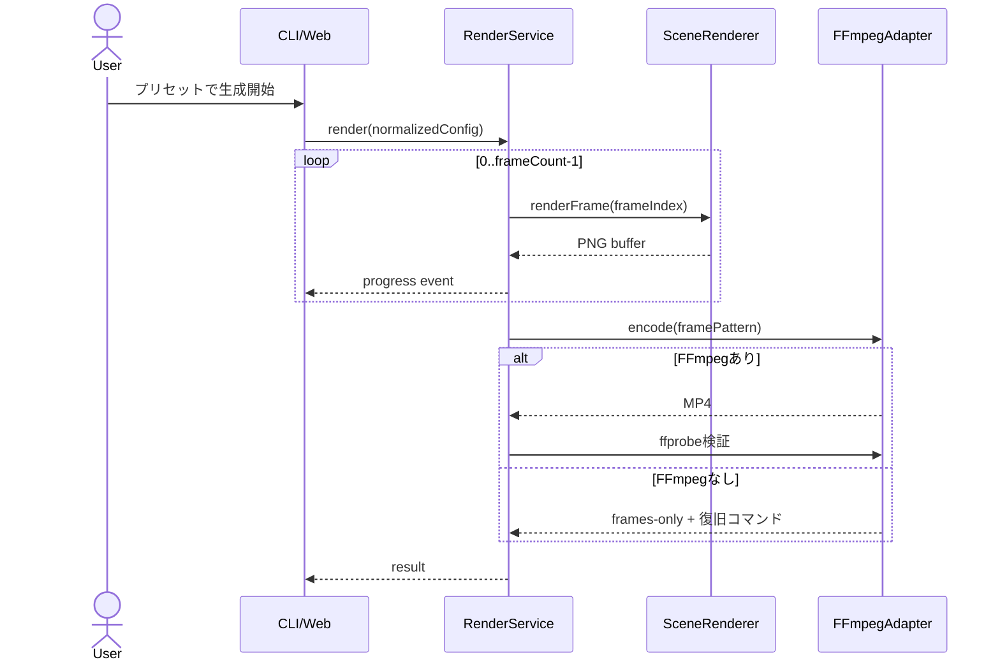

# Kiro Route Studio 設計

## 1. 設計判断

- **言語はESM JavaScript**: Node.js 24で直接実行でき、TypeScriptのビルド工程を省いて締切までの実装・検証時間を短縮する。JSDocとNode.js組み込みテストで境界を明確にする。
- **Canvasは `@napi-rs/canvas`**: OSごとのネイティブビルドを避けるため、プリビルドバイナリを持つ固定バージョンを採用する。ブラウザ用Canvasとの共通化より、クラウドでの確実なPNG生成を優先する。
- **Web UIはNode標準HTTP**: Express等を追加せず、localhost限定の単一プロセスでCLIと同じサービスを呼ぶ。進捗はServer-Sent Events、完成物は許可ディレクトリ内だけを配信する。
- **動画化は外部FFmpeg**: `spawn` の引数配列で起動し、シェル展開を使わない。環境診断ではFFmpeg/FFprobe 8.1.1が利用可能だが、クラウド未導入時は連番PNGを保持して復旧コマンドを表示する。
- **EC2はCloudFormationのみ**: デプロイはせず、単一の短命レンダリングホストをパラメータ化する。SSM接続、IMDSv2、暗号化EBS、インバウンドなし、自動停止を既定とする。

## 2. アーキテクチャ概要

描画に副作用を集中させず、設定、数学、タイムラインを純粋関数として分離する。CLIとWeb UIは同じ `RenderService` を呼び、フレーム書込みとFFmpeg実行だけをアダプターに閉じ込める。

```mermaid
flowchart LR
  CLI[CLI] --> RS[RenderService]
  WEB[localhost Web UI] --> RS
  RS --> CFG[Config normalize]
  RS --> TL[Timeline and route]
  TL --> GEO[Isometric geometry]
  CFG --> SCN[Scene renderer]
  GEO --> SCN
  SCN --> CANVAS[@napi-rs/canvas]
  CANVAS --> PNG[Sequential PNG]
  PNG --> FFMPEG[FFmpeg adapter]
  FFMPEG --> MP4[1080x1920 MP4]
  MP4 --> PROBE[FFprobe validator]
  RS --> PROGRESS[Progress events]
  PROGRESS --> CLI
  PROGRESS --> WEB
```



## 3. コンポーネント

| コンポーネント | パス | 責務 |
|---|---|---|
| CLI | `src/cli.mjs` | 引数解析、終了コード、進捗表示 |
| Web server | `src/web/server.mjs` | localhost UI、SSE、単一ジョブ、成果物配信 |
| Config | `src/core/config.mjs` | JSON読込、既定値、範囲制限、標準形生成 |
| Projection | `src/core/isometric.mjs` | world/screen座標変換、カメラオフセット |
| Route | `src/core/route.mjs` | 距離基準の折れ線補間、進捗計算 |
| Timeline | `src/core/timeline.mjs` | フレーム時刻、イージング、カメラ、テキスト段階 |
| Scene renderer | `src/render/scene-renderer.mjs` | 建物、経路、ゴースト、文字、進捗の合成 |
| Frame writer | `src/render/frame-writer.mjs` | 安全な出力先、連番、PNG書込み |
| Render service | `src/render/render-service.mjs` | 全工程のオーケストレーション、進捗イベント |
| FFmpeg adapter | `src/video/ffmpeg.mjs` | ツール検出、エンコード、ffprobe検証 |
| Scene preset | `scenes/halloween-neon.json` | デモ用の都市、経路、色、文言、シード |
| Tests | `test/**/*.test.mjs` | 単体、統合、プロパティテスト |

## 4. データとアルゴリズム

### 4.1 設定標準形

`normalizeConfig(input)` は次を持つJSON互換オブジェクトを返す。

- `output`: `width=1080`, `height=1920`, `fps=24`, `durationSeconds=12`, `framesDir`, `videoPath`
- `scene`: `seed`, `tileWidth`, `tileHeight`, `origin`, `buildings[]`, `route[]`, `palette`, `title`, `messages[]`
- `camera`: `start`, `end`, `zoomStart`, `zoomEnd`

許容上限はfps 12..60、継続時間 1..180秒、幅/高さは提出設定では1080x1920に固定する。乱数はシード付きの小さな純粋PRNGとし、描画順を変えない。

### 4.2 アイソメトリック投影

カメラ差分適用後のワールド座標 `(x,y)` を、タイル半幅 `a=tileWidth/2`、半高 `b=tileHeight/2`、原点 `(ox,oy)` で次のように変換する。

- `sx = ox + (x - y) * a`
- `sy = oy + (x + y) * b`
- 逆変換: `x = ((sx-ox)/a + (sy-oy)/b)/2`、`y = ((sy-oy)/b - (sx-ox)/a)/2`

建物は `x+y`、次に安定IDで昇順ソートして奥から描く。カメラは経路上のゴーストを追尾しつつ、開始・終了位置間をsmoothstepで補間する。

### 4.3 経路補間

折れ線の各区間長と累積長を前計算する。`t` を `[0,1]` に制限し、`target=t*totalLength` を含む区間内で線形補間する。ゼロ長区間は除外し、全点が同一ならその点を返す。

### 4.4 フレームと動画

`frameCount = round(durationSeconds * fps)`、時刻正規化値はフレーム数1の場合0、それ以外は `frameIndex/(frameCount-1)` とする。PNGは `frame-%06d.png`。FFmpegは概念的に次を実行する。

```text
ffmpeg -y -framerate <fps> -i frame-%06d.png -vf scale=1080:1920:flags=lanczos -c:v libx264 -pix_fmt yuv420p -movflags +faststart output.mp4
```

実装は `spawn(command, args, { shell: false })` を使う。FFprobe JSONから `codec_name=h264`、`pix_fmt=yuv420p`、幅1080、高さ1920、許容差1/fps以内の継続時間を検査する。

## 5. エラー、セキュリティ、運用

- `output/` 配下だけを再帰削除可能にし、resolve後のprefixとルート自身でないことを検査する。
- Webは `127.0.0.1` で待受し、任意コマンド、任意パス、任意HTMLを入力させない。
- 子プロセスはシェルなしで起動し、stdout/stderrを上限付きで保存する。
- EC2テンプレートは秘密を受け取らない。S3は初期版では実装せず、追加時だけAWS SDK for JavaScript v3とインスタンスロールを使う。
- CloudWatch Logsは短期保持、EC2はジョブ後stop、緊急用の停止タイマーも設定する。利用後はスタック削除を手順化する。

## 6. Correctness Properties

各プロパティは同じIDのPBTケースと一対一で対応させる。

| ID | 不変条件 | 生成データ | PBT配置 |
|---|---|---|---|
| CP-01 | 有限な座標と正のタイル寸法について、`screenToWorld(worldToScreen(p))` は許容誤差 `1e-9` 内で `p` に一致する。 | `x,y,origin` の有限double、正のtile寸法 | `test/properties/isometric.property.test.mjs` |
| CP-02 | 固定したyでxを増やすとsxとsyは単調増加し、固定したxでyを増やすとsxは単調減少、syは単調増加する。 | 二つの順序付き座標、正のtile寸法 | `test/properties/isometric.property.test.mjs` |
| CP-03 | 2点以上の非退化経路で `interpolateRoute(route,0)` は始点、`interpolateRoute(route,1)` は終点と一致する。 | 有限点列（隣接重複を許容） | `test/properties/route.property.test.mjs` |
| CP-04 | 任意の `t∈[0,1]` の補間点は経路いずれかの区間上にあり、十分小さい `Δt` に対する移動距離は `totalLength*Δt` を超えない（浮動小数誤差を除く）。 | 経路と二つの近接進捗 | `test/properties/route.property.test.mjs` |
| CP-05 | 任意の受理可能設定 `c` について `normalizeConfig(normalizeConfig(c))` は `normalizeConfig(c)` と深い同値になる。 | 部分設定、境界値、未知キー | `test/properties/config.property.test.mjs` |
| CP-06 | 正規化設定について計画されたフレーム名は0始まりで連続し、重複せず、個数は `round(duration*fps)` と一致する。 | 許容fpsと継続時間 | `test/properties/timeline.property.test.mjs` |
| CP-07 | 同じ正規化設定、シード、フレーム番号から生成したPNGバッファのSHA-256は実行をまたいで一致する。 | 小型テスト設定と任意フレーム | `test/properties/render.property.test.mjs` |
| CP-08 | フレーム0から最終フレームまでの進捗値は常に `[0,100]` にあり、単調非減少で、先頭0、末尾100になる。 | 1以上のフレーム数 | `test/properties/timeline.property.test.mjs` |

fast-checkはテストごとに既定100 runsを用い、レンダリングのCP-07だけは小型Canvasと20 runsに制限する。CI失敗時にシードと縮小済み反例を保持する。

## 7. 要件トレーサビリティ

| 要件 | コンポーネント | 主な検証 |
|---|---|---|
| R-01 | Config, CLI | config単体・CP-05 |
| R-02 | Projection, Scene renderer | CP-01, CP-02, CP-07、スモーク画像 |
| R-03 | Route, Timeline | CP-03, CP-04, CP-08 |
| R-04 | Frame writer, Render service | CP-06、frames-only統合テスト |
| R-05 | FFmpeg adapter | ツールなし単体、実FFmpegスモーク、ffprobe |
| R-06 | Web server | HTTP/SSE統合テスト |
| R-07 | Infra, docs | CloudFormation構文検証、環境手順レビュー |
| R-08 | 全体 | `npm test`, `npm run test:pbt` |
| K-01..K-09 | `.kiro/`, `power/`, `docs/` | 証拠索引と提出チェックリスト |
